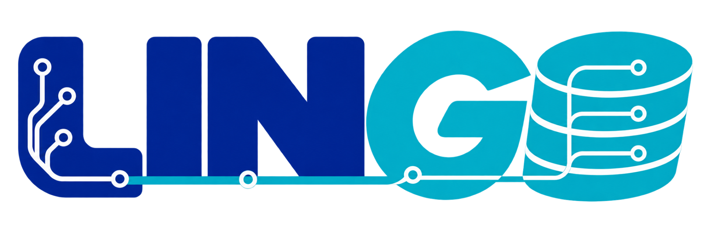
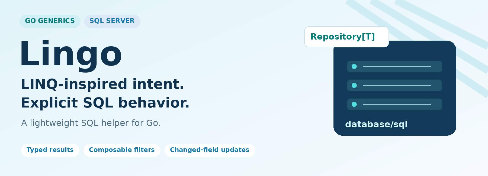
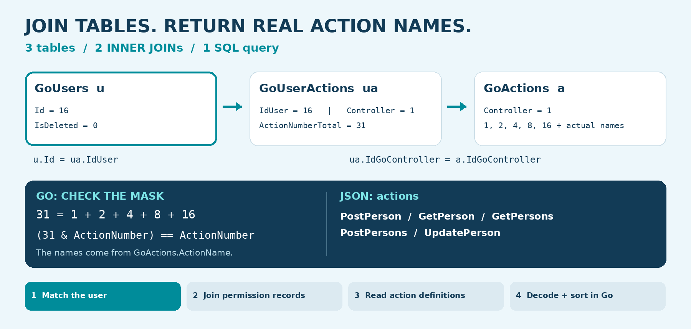
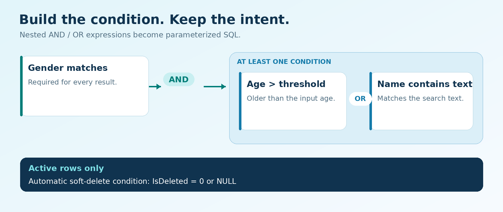
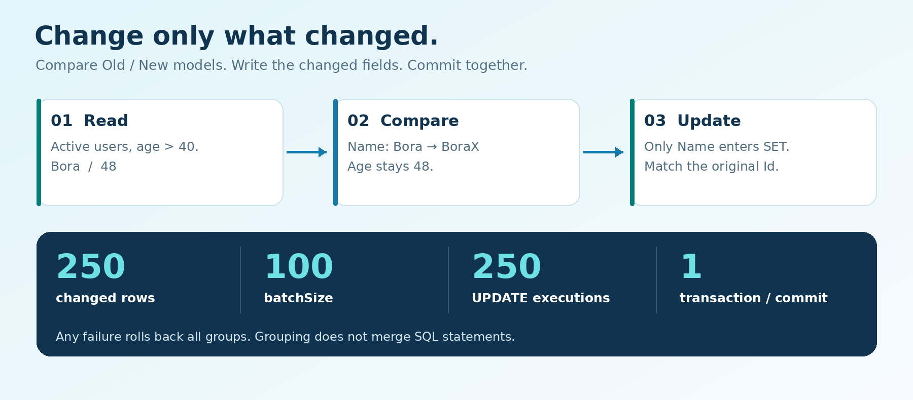

<p align="center">
  
</p>

<p align="center">
  
</p>

<h1 align="center">Lingo</h1>
<p align="center"><strong>A LINQ-inspired SQL helper for Go and SQL Server.</strong><br>
Generic repositories, composable filters, changed-field updates, and explicit transaction control — built on <code>database/sql</code>.</p>

<p align="center">
  <a href="#join-tables-keep-the-sql-explicit">JOINs</a> ·
  <a href="#quick-start">Quick start</a> ·
  <a href="#compose-your-query">Query examples</a> ·
  <a href="#update-only-what-changed">Changed-field updates</a> ·
  <a href="#explore-with-swagger">Swagger</a> ·
  <a href="#api-at-a-glance">API reference</a>
</p>

---

## Small surface. Useful building blocks.

| 🧩 Compose | 🛠️ Update | ⚙️ Control |
|---|---|---|
| Nested **AND / OR** expressions | Write explicit fields or compare **Old / New** | One shared SQL connection pool |
| Parameterized filter values | Skip identity updates | Standard `context.Context` |
| Paging and model-based sorting | Transactional batch updates | Cached model metadata |
| Typed result models | Multi-row INSERT and optional TVP | A runnable `net/http` + Swagger demo |
| INNER / LEFT / RIGHT JOINs | Real permission-name projection | Public API with private JOIN helpers |

The idea is simple: express the query intent in Go, keep the generated SQL understandable, and make transaction boundaries visible. Result models are generic; field names and operators are checked at runtime.

<p align="center">
  
</p>

## Join tables. Keep the SQL explicit.

**Three tables. Two INNER JOINs. One SQL query.** Compose joins with the same filters and model validation used throughout Lingo.

The animation illustrates the execution flow; it is not a live capture or a timing measurement. [View the static diagram](assets/readme/joins.png).

<p align="center">
  
</p>

```go
query := users.Join("u").
    InnerJoin(
        userActions.JoinSource("ua"),
        Repository.EqColumn("ua.IdUser", "u.Id"),
    ).
    InnerJoin(
        actions.JoinSource("a"),
        Repository.EqColumn("a.IdGoController", "ua.IdGoController"),
    ).
    Where(
        Repository.Eq("u.Id", userID),
        Repository.Eq("ua.IdGoController", controllerID),
        Repository.Gt("a.ActionNumber", 0),
    ).
    Select(
        Repository.SelectColumn{Field: "ua.ActionNumberTotal", As: "ActionNumberTotal"},
        Repository.SelectColumn{Field: "a.ActionNumber", As: "ActionNumber"},
        Repository.SelectColumn{Field: "a.ActionName", As: "ActionName"},
    )

rows, err := Repository.JoinFindMany[permissionResult](ctx, query)
```

Here `users`, `userActions`, and `actions` are repositories bound to `Models.PermissionUser`, `Models.UserAction`, and `Models.ActionDefinition`. `permissionResult` is the projection model shown in the complete example below. All repositories use the same open pool; constructing them does not execute a SELECT.

### SQL counterpart — inspect before executing

```go
sqlText, args, err := query.SQL()
if err != nil {
    return nil, err
}
```

`sqlText` contains validated identifiers and placeholders; `args` holds the named values separately. The SQL shape is:

```sql
SELECT [ua].[ActionNumberTotal] AS [ActionNumberTotal],
       [a].[ActionNumber] AS [ActionNumber],
       [a].[ActionName] AS [ActionName]
FROM (SELECT * FROM [dbo].[GoUsers]
      WHERE ISNULL([IsDeleted], 0) = 0) AS [u]
INNER JOIN (SELECT * FROM [dbo].[GoUserActions]
            WHERE ISNULL([IsDeleted], 0) = 0) AS [ua]
    ON ([ua].[IdUser] = [u].[Id])
INNER JOIN (SELECT * FROM [dbo].[GoActions]
            WHERE ISNULL([IsDeleted], 0) = 0) AS [a]
    ON ([a].[IdGoController] = [ua].[IdGoController])
WHERE ([u].[Id] = @p1
   AND [ua].[IdGoController] = @p2
   AND [a].[ActionNumber] > @p3);
```

The parameter values for the example are `16`, `1`, and `0`. This is SQL inspection, not a benchmark or a query execution.


### INNER, LEFT, and RIGHT

| Method | Rows preserved |
|---|---|
| `InnerJoin(source, on...)` | Matching rows on both sides |
| `LeftJoin(source, on...)` | All rows from the left side, with NULLs for unmatched right-side columns |
| `RightJoin(source, on...)` | All rows from the right side, with NULLs for unmatched left-side columns |

“All rows” means the rows remaining after each source's automatic active-row filtering. Multiple ON expressions are combined with **AND**; nested `And(...)` and `Or(...)` groups are supported too.

- **Column vs. value:** `Eq("u.Id", userID)` creates a parameterized comparison.
- **Column vs. column:** `EqColumn("ua.IdUser", "u.Id")` creates a validated column reference, not a string parameter.
- **Short helpers:** `Eq`, `Gt`, and `EqColumn` produce the existing `Filter` type. Full `Filter{...}` expressions remain supported.
- **Aliases:** use `alias.Field` in JOIN filters and SELECT projections. Alias and field names are checked at runtime against the participating model metadata.
- **Projection:** every `As` must match a mapped field name or `db` column name in the result model. Selected columns are scanned in SELECT order; unselected result fields retain their zero values.
- **Soft delete:** when a source model maps `IsDeleted`, that source is filtered with `ISNULL(IsDeleted, 0) = 0` before joining. This preserves LEFT/RIGHT JOIN semantics. A source without a mapped `IsDeleted` field gets no automatic soft-delete filter.
- **Execution:** `JoinFindMany[R]` returns `[]R`; `JoinFindOne[R]` uses `TOP (1)` and returns `R`. No match returns `[]` or `sql.ErrNoRows`, respectively.
- **Ordering:** this JOIN API currently has no `OrderBy` or paging method. `JoinFindOne` has no deterministic first-row guarantee when several rows match.

<details>
<summary><strong>LEFT / RIGHT examples and nullable result models</strong></summary>

Keep users even when they have no active action record:

```go
type UserActionMatch struct {
    UserID       int
    ControllerID *int
}

query := users.Join("u").
    LeftJoin(
        userActions.JoinSource("ua"),
        Repository.EqColumn("ua.IdUser", "u.Id"),
        Repository.Eq("ua.IdGoController", controllerID),
    ).
    Where(Repository.Eq("u.Id", userID)).
    Select(
        Repository.SelectColumn{Field: "u.Id", As: "UserID"},
        Repository.SelectColumn{Field: "ua.IdGoController", As: "ControllerID"},
    )

matches, err := Repository.JoinFindMany[UserActionMatch](ctx, query)
```

The controller filter belongs in **ON** here. Moving it into WHERE would remove users whose right-side match is NULL.

Keep active action records even when they have no active matching user:

```go
type ActionUserMatch struct {
    UserID       *int
    ControllerID int
}

query := users.Join("u").
    RightJoin(
        userActions.JoinSource("ua"),
        Repository.EqColumn("ua.IdUser", "u.Id"),
    ).
    Where(Repository.Eq("ua.IdGoController", controllerID)).
    Select(
        Repository.SelectColumn{Field: "u.Id", As: "UserID"},
        Repository.SelectColumn{Field: "ua.IdGoController", As: "ControllerID"},
    )

matches, err := Repository.JoinFindMany[ActionUserMatch](ctx, query)
```

Use pointers or compatible `sql.Null*` fields for columns that may be NULL. Explicit WHERE filters on the nullable side can intentionally remove unmatched rows.

</details>

### Real example: return a user's action names

The demo endpoint accepts a user ID and controller ID:

```http
GET /api/users/permissions?userID=16&controllerID=1
```

For this sample data, user `16` has `ActionNumberTotal = 31` for controller `1`:

| Table | Relationship / data |
|---|---|
| `GoUsers` | `Id = 16` |
| `GoUserActions` | `IdUser = 16`, `IdGoController = 1`, mask `31` |
| `GoActions` | Controller `1`: `1=PostPerson`, `2=GetPerson`, `4=GetPersons`, `8=PostPersons`, `16=UpdatePerson` |

SQL joins the three tables and reads the real action definitions. Go checks **`(mask & actionNumber) == actionNumber`**, sorts by action number/name, and removes duplicate names. The bitwise check is **not** translated into SQL by this example.

```json
{
  "actions": [
    "PostPerson",
    "GetPerson",
    "GetPersons",
    "PostPersons",
    "UpdatePerson"
  ]
}
```

`31 = 1 + 2 + 4 + 8 + 16`. Names come from `GoActions.ActionName`, not a hardcoded Go map. Definitions from another controller do not join. No matches or no granted actions produce `{"actions":[]}`. These IDs and names are illustrative; use records from your own database.

<details>
<summary><strong>Source models — Models/user_permission.go</strong></summary>

```go
package Models

type PermissionUser struct {
    Id        int
    IsDeleted bool
}

func (PermissionUser) TableName() string { return "dbo.GoUsers" }

type UserAction struct {
    IdUser            int
    IdGoController    int
    ActionNumberTotal int
    IsDeleted         bool
}

func (UserAction) TableName() string { return "dbo.GoUserActions" }

type ActionDefinition struct {
    ActionNumber   int
    ActionName     string
    IdGoController int
    IsDeleted      bool
}

func (ActionDefinition) TableName() string { return "dbo.GoActions" }

type UserPermissionResponse struct {
    Actions []string `json:"actions"`
}
```

This example needs the two permission tables in addition to the minimal `GoUsers` quick-start table. It reads permissions only; it does not create or seed those tables. The mapped fields above are the columns required by this query; other database columns do not have to appear in these source models.

</details>

<details>
<summary><strong>Complete UserRepository.GetUserPermissions implementation</strong></summary>

`UserRepository` keeps the application-owned pool as `db *sql.DB`. This method uses `context`, `sort`, `sqlOrm/Models`, and `sqlOrm/Repository` imports.

```go
func (repo *UserRepository) GetUserPermissions(
    ctx context.Context,
    userID int,
    controllerID int,
) ([]string, error) {
    type permissionResult struct {
        ActionNumberTotal int
        ActionNumber      int
        ActionName        string
    }

    users, err := Repository.NewRepository[Models.PermissionUser](repo.db)
    if err != nil {
        return nil, err
    }
    userActions, err := Repository.NewRepository[Models.UserAction](repo.db)
    if err != nil {
        return nil, err
    }
    actions, err := Repository.NewRepository[Models.ActionDefinition](repo.db)
    if err != nil {
        return nil, err
    }

    query := users.Join("u").
        InnerJoin(userActions.JoinSource("ua"),
            Repository.EqColumn("ua.IdUser", "u.Id"),
        ).
        InnerJoin(actions.JoinSource("a"),
            Repository.EqColumn("a.IdGoController", "ua.IdGoController"),
        ).
        Where(
            Repository.Eq("u.Id", userID),
            Repository.Eq("ua.IdGoController", controllerID),
            Repository.Gt("a.ActionNumber", 0),
        ).
        Select(
            Repository.SelectColumn{Field: "ua.ActionNumberTotal", As: "ActionNumberTotal"},
            Repository.SelectColumn{Field: "a.ActionNumber", As: "ActionNumber"},
            Repository.SelectColumn{Field: "a.ActionName", As: "ActionName"},
        )

    rows, err := Repository.JoinFindMany[permissionResult](ctx, query)
    if err != nil {
        return nil, err
    }

    sort.Slice(rows, func(i, j int) bool {
        if rows[i].ActionNumber == rows[j].ActionNumber {
            return rows[i].ActionName < rows[j].ActionName
        }
        return rows[i].ActionNumber < rows[j].ActionNumber
    })

    names := make([]string, 0)
    seen := make(map[string]bool)
    for _, row := range rows {
        if row.ActionNumberTotal&row.ActionNumber != row.ActionNumber {
            continue
        }
        if !seen[row.ActionName] {
            names = append(names, row.ActionName)
            seen[row.ActionName] = true
        }
    }
    return names, nil
}
```

There are **two INNER JOINs**, not three, and only **one SELECT execution**. Repository construction reuses cached model metadata and the existing pool. The result is a list of names; this demonstration endpoint does not authenticate its caller or enforce access to other routes.

</details>


## Quick start

### 1. Prepare the project

Clone this repository and open a terminal in its root directory. Use the Go version declared in `go.mod` and a reachable SQL Server instance.

```bash
go mod download
```

Set the connection string in your terminal or IDE run configuration:

```bash
export SQL_CONNECTION_STRING='server=localhost;port=1433;user id=demo_user;password=YOUR_PASSWORD;database=Customer;encrypt=true'
```

The demo reads this environment variable. The repository receives an open `*sql.DB`; connection credentials are not part of its query API. Keep real credentials out of source control.

<details>
<summary><strong>Optional: create a minimal table in a fresh demo database</strong></summary>

This schema is for a new demo database, not a migration for an existing application table.

```sql
CREATE TABLE dbo.GoUsers (
    Id        INT IDENTITY(1,1) PRIMARY KEY,
    Name      NVARCHAR(100) NOT NULL,
    Age       INT NOT NULL,
    Gender    NVARCHAR(20) NOT NULL,
    IsDeleted BIT NOT NULL DEFAULT 0
);

INSERT INTO dbo.GoUsers (Name, Age, Gender)
VALUES (N'Bora', 48, N'Male'),
       (N'Secil', 42, N'Female'),
       (N'Duru', 14, N'Female');
```

For a local server with a self-signed certificate, its connection settings may need `TrustServerCertificate=true`. Use a properly configured certificate for a deployed server.

</details>

### 2. Describe a model

```go
package Models

type Person struct {
    Id        int    `json:"id"`
    Name      string `json:"name"`
    Age       int    `json:"age"`
    Gender    string `json:"gender"`
    IsDeleted bool   `json:"-"`
}

func (Person) TableName() string {
    return "dbo.GoUsers"
}
```

`T` is a flat, non-pointer struct. The same repository works with another model and table, such as `Product` and `dbo.Products`.

### 3. Open once. Reuse the pool.

The following setup belongs at application startup. Imports use the project's local module name, `sqlOrm`.

```go
import (
    "context"
    "log"
    "os"
    "time"

    "sqlOrm/DB"
    "sqlOrm/Models"
    "sqlOrm/Repository"
)
```

Inside `main()`:

```go
connectionString := os.Getenv("SQL_CONNECTION_STRING")
if connectionString == "" {
    log.Fatal("SQL_CONNECTION_STRING is required")
}

connectionCtx, cancel := context.WithTimeout(context.Background(), 5*time.Second)
db, err := DB.SqlOpen(connectionCtx, connectionString)
cancel()
if err != nil {
    log.Fatal(err)
}
defer db.Close()

repo, err := Repository.NewRepository[Models.Person](db)
if err != nil {
    log.Fatal(err)
}
```

The table name comes from `TableName()`. An explicit override is also supported:

```go
repo, err := Repository.NewRepository[Models.Person](db, "dbo.GoUsers")
```

Use a fresh request/query context for operations; the startup context above is already canceled after the connection check.

```go
ctx, cancelQuery := context.WithTimeout(context.Background(), 5*time.Second)
defer cancelQuery()

users, err := repo.FindMany(ctx,
    Repository.Filter{Field: "Name", Op: Repository.OpLike, Value: "%Bor%"},
)
```

In an HTTP handler, pass `r.Context()` to propagate request cancellation.

## Compose your query

### Gender matches **AND** (older than the limit **OR** name contains text)

<p align="center">
  
</p>

```go
users, err := repo.FindMany(ctx,
    Repository.And(
        Repository.Filter{Field: "Gender", Op: Repository.OpEq, Value: "Male"},
        Repository.Or(
            Repository.Filter{Field: "Age", Op: Repository.OpGt, Value: 40},
            Repository.Filter{Field: "Name", Op: Repository.OpLike, Value: "%Bor%"},
        ),
    ),
)
```

Equivalent SQL shape, with the selected model columns omitted here for readability:

```sql
SELECT ...
FROM [dbo].[GoUsers]
WHERE (([Gender] = @p1 AND ([Age] > @p2 OR [Name] LIKE @p3)))
  AND ISNULL([IsDeleted], 0) = 0
ORDER BY [Id] ASC;
```

Values are sent separately: `Male`, `40`, `%Bor%`. Multiple filters supplied directly to a read method are combined with **AND**. `%` and `_` in an `OpLike` value retain their SQL wildcard meaning.

<details>
<summary><strong>Coming from C#? Compare the query intent</strong></summary>

```csharp
var users = db.Users
    .Where(x => x.Gender == "Male" &&
        (x.Age > 40 || x.Name.Contains("Bor")))
    .ToList();
```

The Go version expresses the same predicate through `Filter`, `And`, and `Or`. Field names are strings checked against model metadata; this is LINQ-inspired composition rather than a C# expression-tree translator.

</details>

### Available operators

| Operator | SQL | Meaning |
|---|---|---|
| `OpEq` | `=` | Equal |
| `OpNe` | `<>` | Not equal |
| `OpGt` / `OpGte` | `>` / `>=` | Greater than / at least |
| `OpLt` / `OpLte` | `<` / `<=` | Less than / at most |
| `OpLike` | `LIKE` | SQL pattern matching |

For an untyped `nil` value, `OpEq` produces `IS NULL` and `OpNe` produces `IS NOT NULL`.

## Paging + sorting + filters

```go
users, err := repo.GetAllWithPaging(
    ctx,
    2,      // page: skip the first page
    10,     // pageSize
    "Age",  // sorting field
    false,  // descending
    Repository.Filter{Field: "Name", Op: Repository.OpLike, Value: "%a%"},
)
```

| Input to `GetAllWithPaging` | Behavior |
|---|---|
| `page < 1` | Use page `1` |
| `pageSize < 1` | Use `10` |
| `pageSize > 100` | Use `100` |
| No sorting field on a model with `Id` | `Id ASC` |
| Invalid sorting field | Return an error |
| `CreatedDate` sorting column missing in SQL | List/paging query retries with `Id`, keeping filters, direction, and paging |

All mapped fields may be used for sorting. For repeatable paging, prefer a unique sorting field such as `Id`; equal sort values have no guaranteed relative order.

The compact form is available too:

```go
users, err := repo.FindMany(ctx, 2, 10, "Age", false)
```

The default/cap normalization above belongs to `GetAllWithPaging`; direct `FindMany` paging arguments must be positive. One integer passed to `FindMany` means page size, with page `1`.

## Update only what changed

<p align="center">
  
</p>

### Different values per user: `BatchUpdateChanged`

```go
func appendXToNamesOver40(
    ctx context.Context,
    repo *Repository.Repository[Models.Person],
    batchSize int,
) (int64, error) {
    users, err := repo.FindMany(ctx,
        Repository.Filter{Field: "Age", Op: Repository.OpGt, Value: 40},
    )
    if err != nil {
        return 0, err
    }

    pairs := make([]Repository.UpdatePair[Models.Person], 0, len(users))
    for _, oldUser := range users {
        newUser := oldUser
        newUser.Name += "X"

        pairs = append(pairs, Repository.UpdatePair[Models.Person]{
            Old: oldUser,
            New: newUser,
        })
    }

    return repo.BatchUpdateChanged(ctx, pairs, "Id", batchSize)
}
```

For each pair, the helper compares the **supplied** Old/New models. It does not fetch the old row again or perform automatic optimistic concurrency checks.

Only changed fields enter `SET`:

```sql
UPDATE [dbo].[GoUsers]
SET [Name] = @p1
WHERE ([Id] = @p2)
  AND ISNULL([IsDeleted], 0) = 0;
```

**Know exactly what `batchSize` means:**

- It groups the UPDATE commands processed by the loop.
- Every changed record still uses its own UPDATE execution.
- Groups share one transaction and a prepared-statement cache.
- Commit happens once, after every group succeeds; a failure rolls back the transaction.
- `batchSize = 1` and `batchSize = 100` do not combine commands or reduce SQL round trips.
- Omitted or non-positive batch size means one group. Unchanged records issue no UPDATE.

For **250 changed records**, both sizes still mean **250 UPDATE executions, one transaction, one commit**. Grouping alone is not a network-performance optimization.

### Same operation for all matches: `BulkUpdateWithFilter`

Append `X` to all active users older than 40 with **one SQL UPDATE**, without reading them first:

```go
affected, err := repo.BulkUpdateWithFilter(
    ctx,
    map[string]any{
        "Name": Models.RawValue{Expr: "[Name] + N'X'"},
    },
    Repository.Filter{Field: "Age", Op: Repository.OpGt, Value: 40},
)
```

```sql
UPDATE [dbo].[GoUsers]
SET [Name] = [Name] + N'X'
WHERE ([Age] > @p1)
  AND ISNULL([IsDeleted], 0) = 0;
```

`RawValue` is an explicit SQL escape hatch for expressions defined by the developer. Never populate its expression from request input. Re-running either append example adds another `X`.

<details>
<summary><strong>More write examples: Insert, Update, UpdateChanged, and BatchUpdate</strong></summary>

**Insert one model.** The Go field named `Id` is skipped as an identity field.

```go
affected, err := repo.Insert(ctx, Models.Person{
    Name: "New user", Age: 28, Gender: "Female",
})
```

**Update explicitly supplied fields.** Zero, false, and nil values are retained.

```go
affected, err := repo.Update(ctx,
    map[string]any{"Age": 0, "Name": "Updated name"},
    Repository.Filter{Field: "Id", Op: Repository.OpEq, Value: 16},
)
```

**Compare one pair.**

```go
oldUser, err := repo.GetByID(ctx, 16)
if err != nil {
    return err
}
newUser := *oldUser
newUser.Name += "X"

affected, err := repo.UpdateChanged(ctx, *oldUser, newUser,
    Repository.Filter{Field: "Id", Op: Repository.OpEq, Value: oldUser.Id},
)
```

**Write different fields/filters in one transaction.**

```go
affected, err := repo.BatchUpdate(ctx, []Repository.UpdateItem{
    {
        Values: map[string]any{"Age": 49},
        Filters: []Repository.Expr{
            Repository.Filter{Field: "Id", Op: Repository.OpEq, Value: 16},
        },
    },
    {
        Values: map[string]any{"Name": "Updated name"},
        Filters: []Repository.Expr{
            Repository.Filter{Field: "Id", Op: Repository.OpEq, Value: 17},
        },
    },
}, 100)
```

`BatchUpdate` writes what you explicitly provide. `BatchUpdateChanged` first computes changes from Old/New pairs, then uses the batch-update pipeline. Neither silently re-reads the old database state.

</details>

## Insert multiple rows

```go
affected, err := repo.BulkInsertBatched(ctx, []Models.Person{
    {Name: "First user", Age: 25, Gender: "Female"},
    {Name: "Second user", Age: 32, Gender: "Male"},
}, 100)
```

This method builds **multi-row INSERT statements**, splitting them to respect SQL Server's parameter/row limits. All INSERT groups share one transaction. This differs from batch UPDATE, which executes one UPDATE per changed record.

<details>
<summary><strong>Advanced: TVP / stored-procedure insert</strong></summary>

`BulkInsert` is the optional table-valued parameter path:

```go
err := repo.BulkInsert(ctx, rows, "dbo.UserTableType", "dbo.InsertUsersBulk", 100)
```

Create the SQL table type and stored procedure first. Use a dedicated row model if needed: TVP struct fields must match the SQL table type's column order and types. This path passes the full `T`; normal INSERT's automatic `Id` omission does not apply. The procedure determines the target table and its internal SQL behavior.

</details>

## Explore with Swagger

The included demo uses `net/http` and your generic repository through a thin `UserRepository` / `UserHandler` layer.

```bash
go run github.com/swaggo/swag/cmd/swag@latest init -g main.go -o docs
go run .
```

Open **[Swagger UI](http://localhost:8080/swagger/index.html)**, select **Try it out**, enter values, and execute.

| Method | Endpoint | Demonstrates |
|---|---|---|
| `GET` | `/api/users?name=Bor` | Name contains text |
| `GET` | `/api/users/paging?page=1&pageSize=4&sortBy=Age&ascending=false` | Paging and sorting |
| `GET` | `/api/users/search?gender=Male&age=40&name=Bor` | **Gender AND (Age OR Name)** |
| `POST` | `/api/users/append-x-over-40?batchSize=100` | Changed-field batch update |
| `GET` | `/api/users/permissions?userID=16&controllerID=1` | Three-table JOIN + real action names |

Example write response:

```json
{
  "updatedCount": 2
}
```

The POST endpoint modifies the demo data. A zero affected-row count is valid and does not itself mean an error.

## API at a glance

| Method | Purpose | Result |
|---|---|---|
| `NewRepository[T]` | Bind a model, pool, and optional table name | `*Repository[T], error` |
| `Eq` / `Gt` / `EqColumn` | Compact value / column comparisons | `Filter` |
| `Join` / `JoinSource` | Start an aliased query / supply a source | Query builder / source |
| `InnerJoin` / `LeftJoin` / `RightJoin` | Add a table and ON expressions | Query builder |
| `Where` / `Select` / `SQL` | Define filters, projection, inspect SQL | Builder / SQL and parameters |
| `JoinFindMany[R]` | Read a JOIN projection list | `[]R, error` |
| `JoinFindOne[R]` | Read TOP (1) projection | `R, error` |
| `Get` / `FindMany` | Read with filters, order, optional paging | `[]T, error` |
| `GetAll` | Read active rows | `[]T, error` |
| `FindOne` / `GetByID` | Read one active row | `*T, error` |
| `GetAllWithPaging` | Normalize paging inputs and read | `[]T, error` |
| `Insert` | Insert one model | `int64, error` |
| `BulkInsertBatched` | Transactional multi-row INSERT groups | `int64, error` |
| `BulkInsert` | Optional TVP / procedure insert | `error` |
| `Update` / `BulkUpdateWithFilter` | Explicit fields and predicates | `int64, error` |
| `UpdateChanged` | Compare one Old/New pair | `int64, error` |
| `BatchUpdate` | Transactional explicit update items | `int64, error` |
| `BatchUpdateChanged` | Transactional Old/New pairs | `int64, error` |

## Behavior you can rely on

- **Active rows:** SELECT and UPDATE add `ISNULL([IsDeleted], 0) = 0`. Target tables need that column. An extra `IsDeleted = false` filter would exclude NULL rows, so it is unnecessary for normal active-row queries.
- **Models and tags:** Go field names are the default SQL names. `db:"ColumnName"` overrides them; `db:"-"` skips mapping. `json` controls JSON serialization only. Nullable SQL values need compatible pointer or `sql.Null*` model fields.
- **Identity protection:** The Go field named `Id` is skipped during normal INSERT and UPDATE. In changed-pair batches, the matching identifier is excluded from SET and the original key locates the row.
- **Explicit predicates:** Update methods reject an empty WHERE expression. The automatic soft-delete condition does not count as the explicit filter. A broad predicate can still match many rows.
- **Results:** Empty list reads return `[]`; single reads return `sql.ErrNoRows`. Write counts are affected rows, not generated identity values.
- **Reflection:** Field metadata is cached by model type. Scanning values and comparing models still use reflection. The cache is not a database schema cache.
- **Scope:** This project demonstrates repository/query helpers. It does not provide migrations, automatic relationship loading, a general expression translator, or an automatic entity-tracking session. Comparisons are explicit Old/New operations.

<details>
<summary><strong>Single-record error handling</strong></summary>

```go
user, err := repo.GetByID(ctx, 16)
if errors.Is(err, sql.ErrNoRows) {
    // Return HTTP 404, for example.
    return nil
}
if err != nil {
    return err
}
// Use user here.
```

This fragment assumes an error-returning function and imports `errors` and `database/sql`.

</details>

## Project map

| Location | Responsibility |
|---|---|
| `DB/sql.go` | Open and verify a SQL Server connection pool |
| `Models/` | Demo `Person`, permission models, and `RawValue` |
| `Repository/operator.go` | Supported comparison operators |
| `Repository/filter.go` | Field/operator/value filters |
| `Repository/expression.go` | AND / OR groups |
| `Repository/model_helpers.go` | Field mapping, metadata cache, row scanning |
| `Repository/query_helpers.go` | Parameterized WHERE construction |
| `Repository/repository.go` | Public API: reads, writes, paging, transactions, JOIN adapters |
| `Repository/join_types.go` | Private JOIN source and clause types |
| `Repository/join_query.go` | Private JOIN builder state |
| `Repository/join_sql.go` | Alias/column validation and JOIN SQL generation |
| `Repository/join_execute.go` | Generic projection execution and scanning |
| `User/` | Demo repository and HTTP handlers |
| `docs/` | Generated Swagger specification |
| `main.go` | Application startup, pool lifecycle, HTTP routes |

### Publishing and local development

Lingo is the project name. Examples retain the current local module name `sqlOrm`. When publishing under a GitHub module path, update `go.mod` and internal imports together. The demo API lives in the same module; import its `Repository` subpackage from other applications after publishing.

The local `run-local.sh` setup can source your shell environment before `go run .`. It is a convenience for launching the demo, not a Go debugger configuration. Rebuild Swagger files after editing endpoint annotations.

For the legacy SQL Server certificate error `x509: negative serial number`, the demo's local compatibility setting is `GODEBUG=x509negativeserial=1`. That setting permits the certificate to be parsed; it does not repair the certificate.

---

Built by **[Bora Kaşmer](https://github.com/borakasmer)** · [borakasmer.com](https://borakasmer.com/)

*Typed models. Readable intent. Explicit SQL behavior.*
