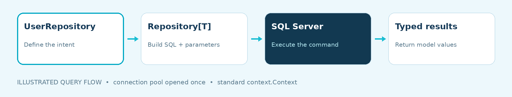
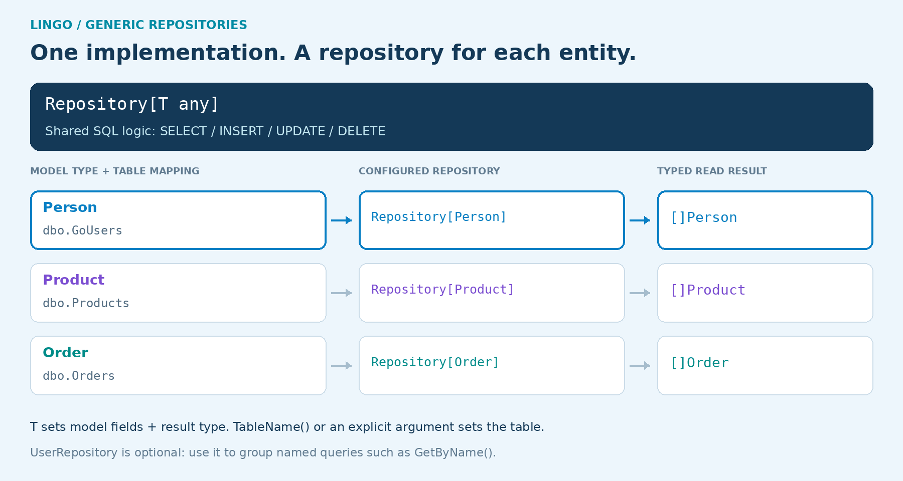
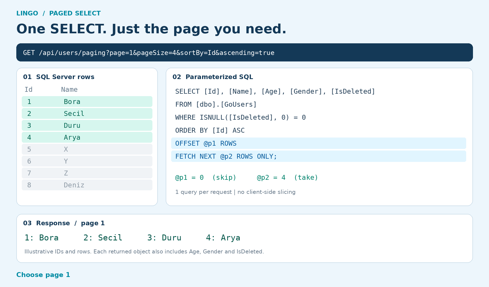
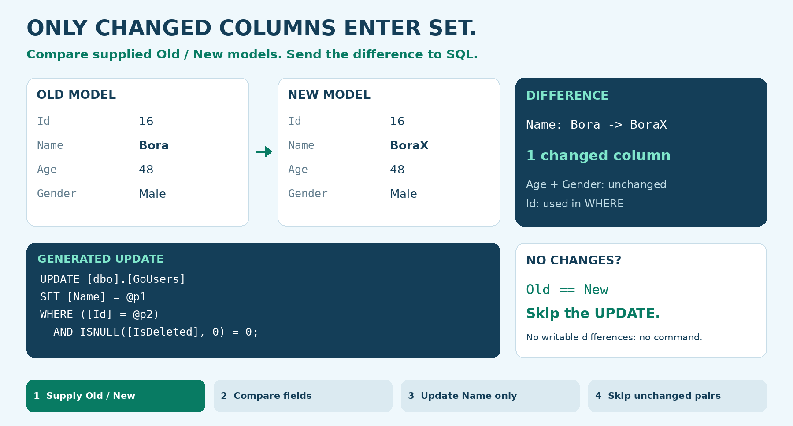
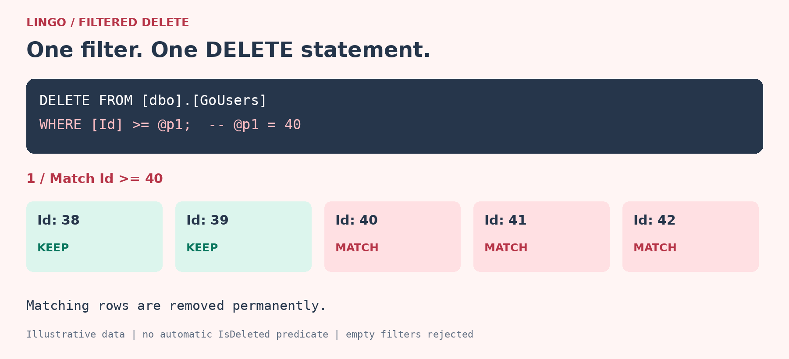

<p align="center">
  
</p>

<p align="center">
  
</p>

<p align="center"><strong>A LINQ-inspired SQL helper for Go and SQL Server.</strong><br>
Generic repositories, composable filters, changed-field updates, and explicit transaction control, built on <code>database/sql</code>.</p>

<p align="center">
  <a href="#start-with-a-paged-select">Paged SELECT</a> ·
  <a href="#join-tables-keep-the-sql-explicit">JOINs</a> ·
  <a href="#quick-start">Quick start</a> ·
  <a href="#compose-your-query">Query examples</a> ·
  <a href="#update-only-what-changed">Changed-field updates</a> ·
  <a href="#delete-with-filter">Filtered DELETE</a> ·
  <a href="#explore-with-swagger">Swagger</a> ·
  <a href="#api-at-a-glance">API reference</a>
</p>

---

<a id="overview"></a>

## Overview: What Lingo Offers


| Compose | Update | Control |
|---|---|---|
| Nested **AND / OR** expressions | Write explicit fields or compare **Old / New** | One shared SQL connection pool |
| Parameterized filter values | Skip identity updates | Standard `context.Context` |
| Paging and model-based sorting | Transactional batch updates | Cached model metadata |
| Typed result models | Multi-row INSERT and optional TVP | A runnable `net/http` + Swagger demo |
| INNER / LEFT / RIGHT JOINs | Flat result projections | Public API with private JOIN helpers |

**Read the examples in order:** paged SELECT → multi-table JOINs → setup → filters → writes. Each example keeps the Go call, SQL counterpart, and result together.

The idea is simple: express the query intent in Go, keep the generated SQL understandable, and make transaction boundaries visible. Result models are generic; field names and operators are checked at runtime.

<p align="center">
  
</p>

<p align="center">
  
</p>

**Choose the entity. Supply its table mapping. Reuse the same repository operations.** `Repository[Person]` works with user records, while `Repository[Product]` works with product records. No duplicated SQL implementation is needed. The animation illustrates configurations; it does not create tables or execute live queries.

<a id="start-with-a-paged-select"></a>

## Paged SELECT: Pagination & Sorting


**Read four users at a time. Let SQL Server do the paging.** Start with a familiar SELECT before composing multi-table JOINs.

<p align="center">
  
</p>

The animation uses illustrative records, not a live database capture. [View the static diagram](assets/readme/paging.png).

#### 1. Swagger request

The runnable demo already exposes this route:

```go
mux.HandleFunc("/api/users/paging", userHandler.GetAllWithPaging)
```

Open `/swagger/index.html`, expand **GET /api/users/paging**, and enter:

| Parameter | Value | Meaning |
|---|---|---|
| `page` | `2` | Read the second page |
| `pageSize` | `4` | Return at most four users |
| `sortBy` | `Id` | Sort by the unique ID |
| `ascending` | `true` | Ascending order |

```http
GET /api/users/paging?page=2&pageSize=4&sortBy=Id&ascending=true
```

#### 2. Go repository call

Inside `UserRepository`, the generic repository reads the page:

```go
users, err := repo.repository.GetAllWithPaging(
    ctx,
    2,     // page
    4,     // pageSize
    "Id",  // sortBy
    true,  // ascending
)
if err != nil {
    return nil, err
}
return users, nil
```

#### 3. Generated SQL

For the `Person` model with `Id`, `Name`, `Age`, `Gender`, and `IsDeleted`, the query has this form:

```sql
SELECT [Id], [Name], [Age], [Gender], [IsDeleted]
FROM [dbo].[GoUsers]
WHERE ISNULL([IsDeleted], 0) = 0
ORDER BY [Id] ASC
OFFSET @p1 ROWS
FETCH NEXT @p2 ROWS ONLY;

-- @p1 = 4  : (page - 1) * pageSize
-- @p2 = 4  : pageSize
```

The SELECT column order follows the mapped model fields; the example above follows the current `Person` definition. Parameter names here illustrate skip/take binding.

**SQL Server skips the first four matching rows and returns the next four.** The application does not fetch the entire table and slice it in memory. This is one SELECT per request; total-count metadata is not included in this list response.

#### 4. JSON response

```json
[
  {"id": 5, "name": "X",     "age": 25, "gender": "Male",   "isDeleted": false},
  {"id": 6, "name": "Y",     "age": 30, "gender": "Female", "isDeleted": false},
  {"id": 7, "name": "Z",     "age": 35, "gender": "Male",   "isDeleted": false},
  {"id": 8, "name": "Deniz", "age": 28, "gender": "Female", "isDeleted": false}
]
```

IDs and values above are illustrative: page 2 means the next four rows in the sorted result, not necessarily IDs 5-8. Prefer a unique sort key such as `Id` for stable ordering. Separate requests can still see changes if rows are inserted or deleted between them. If `sortBy` is blank, the demo uses `Id`; `ascending` controls the direction.

<a id="paging--sorting--filters"></a>

#### 5. Add a filter to the page

Use the same `GetAllWithPaging` method with an additional predicate. This example reads page 2 of names containing `a`, sorted by age descending. This generic repository call supports filters; the basic HTTP paging demo above does not expose a name-filter parameter.

```go
users, err := repo.GetAllWithPaging(
    ctx,
    2,      // page: skip the first page
    10,     // pageSize
    "Age",  // sorting field
    false,  // descending
    Repository.Filter{
        Field: "Name",
        Op:    Repository.OpLike,
        Value: "%a%",
    },
)
```

#### 6. Defaults & limits

| Input to `GetAllWithPaging` | Behavior |
|---|---|
| `page < 1` | Use page `1` |
| `pageSize < 1` | Use `10` |
| `pageSize > 100` | Use `100` |
| No sorting field on a model with `Id` | `Id ASC` |
| Invalid sorting field | Return an error |
| `CreatedDate` sorting column missing in SQL | List/paging query retries with `Id`, keeping filters, direction, and paging |

All mapped fields may be used for sorting. For repeatable paging, prefer a unique sorting field such as `Id`; equal sort values have no guaranteed relative order.

#### 7. Alternative: direct `FindMany` paging

The compact form is available too:

```go
users, err := repo.FindMany(ctx, 2, 10, "Age", false)
```

The default/cap normalization above belongs to `GetAllWithPaging`; direct `FindMany` paging arguments must be positive. One integer passed to `FindMany` means page size, with page `1`.

<a id="join-tables-keep-the-sql-explicit"></a>

## JOIN Queries: Three Tables, One SELECT


**Which customer ordered which product? Three tables. Two INNER JOINs. One SQL query.**

This small teaching schema connects **Customers → Orders → Products**. Each order in this example refers to one product; a production schema with multiple products per order would normally add an order-line table.

<p align="center">
  
</p>

The animation explains the table matches and SQL; it is not a live recording or performance measurement. [View the static diagram](assets/readme/joins.png).

#### 1. The data

**Customers**

| Id | Name |
|---|---|
| 1 | Bora |
| 2 | Secil |

**Orders**

| Id | CustomerID | ProductID | Quantity |
|---|---|---|---|
| 1001 | 1 | 10 | 1 |
| 1002 | 1 | 20 | 2 |

**Products**

| Id | Name |
|---|---|
| 10 | Keyboard |
| 20 | Mouse |

The foreign keys determine the matches. All three sample tables also contain `IsDeleted`; the rows shown are active.

#### 2. Express it in Go

`customers`, `orders`, and `products` are generic repositories using the same open pool. Select a flat result model:

```go
type CustomerOrder struct {
    OrderID      int    `json:"orderId"`
    CustomerName string `json:"customerName"`
    ProductName  string `json:"productName"`
    Quantity     int    `json:"quantity"`
}
```

```go
query := customers.Join("c").
    InnerJoin(
        orders.JoinSource("o"),
        Repository.EqColumn("o.CustomerID", "c.Id"),
    ).
    InnerJoin(
        products.JoinSource("p"),
        Repository.EqColumn("p.Id", "o.ProductID"),
    ).
    Where(Repository.Eq("c.Id", customerID)).
    Select(
        Repository.SelectColumn{Field: "o.Id", As: "OrderID"},
        Repository.SelectColumn{Field: "c.Name", As: "CustomerName"},
        Repository.SelectColumn{Field: "p.Name", As: "ProductName"},
        Repository.SelectColumn{Field: "o.Quantity", As: "Quantity"},
    )

rows, err := Repository.JoinFindMany[CustomerOrder](ctx, query)
```

- The first JOIN matches an order's `CustomerID` to the customer's `Id`.
- The second JOIN matches the order's `ProductID` to the product's `Id`.
- WHERE selects one customer. `customerID` is sent as a SQL parameter.
- SELECT maps the four requested columns into `CustomerOrder`.

`EqColumn` compares two validated columns. `Eq` compares a validated column with a parameter value. Both create ordinary `Filter` expressions; full `Filter{...}`, `And(...)`, and `Or(...)` remain supported.

#### 3. See the SQL counterpart

The relationship is easy to recognize in SQL:

```sql
-- Relationship-only view; automatic active-row filters are expanded below.
SELECT o.Id AS OrderID,
       c.Name AS CustomerName,
       p.Name AS ProductName,
       o.Quantity AS Quantity
FROM dbo.Customers AS c
INNER JOIN dbo.Orders AS o ON o.CustomerID = c.Id
INNER JOIN dbo.Products AS p ON p.Id = o.ProductID
WHERE c.Id = @p1;
```

Inspect Lingo's SQL and named parameters before execution:

```go
sqlText, args, err := query.SQL()
if err != nil {
    return nil, err
}
```

With `IsDeleted` mapped in all three source models, Lingo generates this SQL shape:

```sql
SELECT [o].[Id] AS [OrderID],
       [c].[Name] AS [CustomerName],
       [p].[Name] AS [ProductName],
       [o].[Quantity] AS [Quantity]
FROM (SELECT * FROM [dbo].[Customers]
      WHERE ISNULL([IsDeleted], 0) = 0) AS [c]
INNER JOIN (SELECT * FROM [dbo].[Orders]
            WHERE ISNULL([IsDeleted], 0) = 0) AS [o]
    ON ([o].[CustomerID] = [c].[Id])
INNER JOIN (SELECT * FROM [dbo].[Products]
            WHERE ISNULL([IsDeleted], 0) = 0) AS [p]
    ON ([p].[Id] = [o].[ProductID])
WHERE ([c].[Id] = @p1);
```

**Parameter:** `@p1 = 1`. The parentheses and quoted identifiers come from the builder; values remain separate from SQL text.

#### 4. Read the result

For customer `1` (Bora), the sample data produces these two rows:

```json
[
  {"orderId": 1001, "customerName": "Bora", "productName": "Keyboard", "quantity": 1},
  {"orderId": 1002, "customerName": "Bora", "productName": "Mouse", "quantity": 2}
]
```

This is a result illustration, not an added HTTP endpoint. Row order is not guaranteed: the current JOIN builder has no `OrderBy` or paging method. There are **two JOINs and one SELECT execution**; no additional per-row lookups are needed.

<details>
<summary><strong>Complete standalone Go example: models, repositories, query, result</strong></summary>

This example uses dedicated tables in an existing demo database. It does not create tables or modify the running User API. Imports are `context`, `database/sql`, and `sqlOrm/Repository`.

```go
func getCustomerOrders(
    ctx context.Context,
    db *sql.DB,
    customerID int,
) ([]CustomerOrder, error) {
    type customer struct {
        Id        int
        Name      string
        IsDeleted bool
    }
    type order struct {
        Id         int
        CustomerID int
        ProductID  int
        Quantity   int
        IsDeleted  bool
    }
    type product struct {
        Id        int
        Name      string
        IsDeleted bool
    }

    customers, err := Repository.NewRepository[customer](db, "dbo.Customers")
    if err != nil {
        return nil, err
    }
    orders, err := Repository.NewRepository[order](db, "dbo.Orders")
    if err != nil {
        return nil, err
    }
    products, err := Repository.NewRepository[product](db, "dbo.Products")
    if err != nil {
        return nil, err
    }

    query := customers.Join("c").
        InnerJoin(orders.JoinSource("o"),
            Repository.EqColumn("o.CustomerID", "c.Id"),
        ).
        InnerJoin(products.JoinSource("p"),
            Repository.EqColumn("p.Id", "o.ProductID"),
        ).
        Where(Repository.Eq("c.Id", customerID)).
        Select(
            Repository.SelectColumn{Field: "o.Id", As: "OrderID"},
            Repository.SelectColumn{Field: "c.Name", As: "CustomerName"},
            Repository.SelectColumn{Field: "p.Name", As: "ProductName"},
            Repository.SelectColumn{Field: "o.Quantity", As: "Quantity"},
        )

    return Repository.JoinFindMany[CustomerOrder](ctx, query)
}
```

Use the `CustomerOrder` result type above. The local source models reuse the metadata cache and only include the columns needed by this example. Explicit table names avoid needing `TableName()` methods on these local types. The table names and columns belong to this teaching schema; adapt them to your actual database.

</details>

#### INNER, LEFT, and RIGHT

| Method | What it preserves | Customer/order example |
|---|---|---|
| `InnerJoin` | Matching rows on both sides | Customers with matching orders |
| `LeftJoin` | All left-side rows; unmatched right columns become NULL | Keep customers even when they have no orders |
| `RightJoin` | All right-side rows; unmatched left columns become NULL | Keep orders even when no active customer matches |

“All rows” means the rows remaining after each source's automatic active-row filtering. When a source model maps `IsDeleted`, Lingo filters that source with `ISNULL(IsDeleted, 0) = 0` before joining. A model without a mapped `IsDeleted` field gets no automatic soft-delete condition.

<details>
<summary><strong>LEFT and RIGHT examples with nullable projections</strong></summary>

Using the same `customers` and `orders` repositories, keep customers without matching orders:

```go
type CustomerOrderMatch struct {
    CustomerName string
    OrderID      *int
}

query := customers.Join("c").
    LeftJoin(orders.JoinSource("o"),
        Repository.EqColumn("o.CustomerID", "c.Id"),
    ).
    Select(
        Repository.SelectColumn{Field: "c.Name", As: "CustomerName"},
        Repository.SelectColumn{Field: "o.Id", As: "OrderID"},
    )

rows, err := Repository.JoinFindMany[CustomerOrderMatch](ctx, query)
```

Keep orders without an active matching customer:

```go
type OrderCustomerMatch struct {
    OrderID      int
    CustomerName *string
}

query := customers.Join("c").
    RightJoin(orders.JoinSource("o"),
        Repository.EqColumn("o.CustomerID", "c.Id"),
    ).
    Select(
        Repository.SelectColumn{Field: "o.Id", As: "OrderID"},
        Repository.SelectColumn{Field: "c.Name", As: "CustomerName"},
    )

rows, err := Repository.JoinFindMany[OrderCustomerMatch](ctx, query)
```

Use pointers or compatible `sql.Null*` fields for nullable columns. Explicit WHERE comparisons on the nullable side can remove unmatched rows; put a right-side matching restriction in LEFT JOIN's ON clause when unmatched left rows must remain.

</details>

Every JOIN field uses `alias.Field` and is checked against participating model metadata. Multiple ON expressions combine with AND. Each SELECT `As` must map to a result field or its `db` name. `JoinFindMany[R]` returns `[]R` (empty `[]` on no match); `JoinFindOne[R]` returns `R` or `sql.ErrNoRows`, uses `TOP (1)`, and has no deterministic first-row guarantee without a unique match.


<a id="quick-start"></a>

## Quick Start: Run the Demo


#### 1. Prepare the project

Clone this repository and open a terminal in its root directory. Use the Go version declared in `go.mod` and a reachable SQL Server instance.

```bash
go mod download
```

Set the connection string in your terminal or IDE run configuration:

```bash
export SQL_CONNECTION_STRING='server=localhost;port=1433;user id=demo_user;password=YOUR_PASSWORD;database=Customer;encrypt=true'
```

The demo reads this environment variable. The repository receives an open `*sql.DB`; connection credentials are not part of its query API. Keep real credentials out of source control.

<details>
<summary><strong>Optional: create a minimal table in a fresh demo database</strong></summary>

This schema is for a new demo database, not a migration for an existing application table.

```sql
CREATE TABLE dbo.GoUsers (
    Id        INT IDENTITY(1,1) PRIMARY KEY,
    Name      NVARCHAR(100) NOT NULL,
    Age       INT NOT NULL,
    Gender    NVARCHAR(20) NOT NULL,
    IsDeleted BIT NOT NULL DEFAULT 0
);

INSERT INTO dbo.GoUsers (Name, Age, Gender)
VALUES (N'Bora', 48, N'Male'),
       (N'Secil', 42, N'Female'),
       (N'Duru', 14, N'Female');
```

For a local server with a self-signed certificate, its connection settings may need `TrustServerCertificate=true`. Use a properly configured certificate for a deployed server.

</details>

#### 2. Describe a model

```go
package Models

type Person struct {
    Id        int    `json:"id"`
    Name      string `json:"name"`
    Age       int    `json:"age"`
    Gender    string `json:"gender"`
    IsDeleted bool   `json:"-"`
}

func (Person) TableName() string {
    return "dbo.GoUsers"
}
```

`T` is a flat, non-pointer struct. The same repository works with another model and table, such as `Product` and `dbo.Products`.

#### 3. Open once. Reuse the pool.

The following setup belongs at application startup. Imports use the project's local module name, `sqlOrm`.

```go
import (
    "context"
    "log"
    "os"
    "time"

    "sqlOrm/DB"
    "sqlOrm/Models"
    "sqlOrm/Repository"
)
```

Inside `main()`:

```go
connectionString := os.Getenv("SQL_CONNECTION_STRING")
if connectionString == "" {
    log.Fatal("SQL_CONNECTION_STRING is required")
}

connectionCtx, cancel := context.WithTimeout(context.Background(), 5*time.Second)
db, err := DB.SqlOpen(connectionCtx, connectionString)
cancel()
if err != nil {
    log.Fatal(err)
}
defer db.Close()

repo, err := Repository.NewRepository[Models.Person](db)
if err != nil {
    log.Fatal(err)
}
```

The table name comes from `TableName()`. An explicit override is also supported:

```go
repo, err := Repository.NewRepository[Models.Person](db, "dbo.GoUsers")
```

Use a fresh request/query context for operations; the startup context above is already canceled after the connection check.

```go
ctx, cancelQuery := context.WithTimeout(context.Background(), 5*time.Second)
defer cancelQuery()

users, err := repo.FindMany(ctx,
    Repository.Filter{Field: "Name", Op: Repository.OpLike, Value: "%Bor%"},
)
```

In an HTTP handler, pass `r.Context()` to propagate request cancellation.

#### 4. Understand `T` and your application repository

**Give Lingo a model and its table mapping. It becomes the repository for that entity.**

You do not write the same SELECT, INSERT, UPDATE, and DELETE infrastructure for every table. `Repository[T]` is the reusable implementation; `NewRepository[T]` creates a configured instance for the entity you supply.

| Model supplied as `T` | Table mapping | Repository instance |
|---|---|---|
| `Models.Person` | `dbo.GoUsers` | A repository for user records |
| `Product` | `dbo.Products` | A repository for product records |
| `Order` | `dbo.Orders` | A repository for order records |

The table mapping comes from the model's `TableName()` method or the explicit `tableName` argument. Lingo does **not** infer or create a database table from the Go type name.

```go
// Person supplies its mapping through TableName().
users, err := Repository.NewRepository[Models.Person](db)
if err != nil {
    return err
}

// A different entity and table, using the same implementation.
// This local type illustrates an existing dbo.Products table.
type Product struct {
    Id        int
    Name      string
    IsDeleted bool
}

products, err := Repository.NewRepository[Product](db, "dbo.Products")
if err != nil {
    return err
}

userRows, err := users.FindMany(ctx)
if err != nil {
    return err
}
productRows, err := products.FindMany(ctx)
if err != nil {
    return err
}

// userRows: []Models.Person
// productRows: []Product
// Use both results in your application.
_ = userRows
_ = productRows
```

This fragment assumes `db` and `ctx` in an error-returning function. The example product table must already exist and contain the mapped columns.

**Each instance keeps its own model fields, table, SELECT columns, and default sort.** The SQL implementation is shared, the connection pool can be shared, and field metadata is cached by model type. Two instances can even use the same `T` with different explicit table names when their schemas match.

A separate handwritten `UserRepository`, `ProductRepository`, or `OrderRepository` is **optional**. Add one when you want named application queries; the generic repository already provides the shared data operations.

The core repository is declared once:

```go
type Repository[T any] struct {
    db           *sql.DB
    table        string
    fields       []modelField
    columns      string
    defaultOrder string
}
```

`T` is a type parameter: replace it with the model the repository should read or write. `any` is the Go constraint; the constructor also checks at runtime that the model is a supported flat, non-pointer struct.

| Constructed repository | What `T` means | List result type |
|---|---|---|
| `Repository[Models.Person]` | `Models.Person` | `[]Models.Person` |
| `Repository[Product]` | Your `Product` struct | `[]Product` |

The constructor binds that model to a SQL connection pool and a table:

```go
people, err := Repository.NewRepository[Models.Person](db)
```

`NewRepository` gets cached field metadata, resolves `TableName()` or an explicit table name, and prepares the quoted column names and default sorting field. It does not load table rows. The pool is shared; creating a repository does not create another `sql.DB` pool. An explicitly supplied table name takes precedence over `TableName()`.

Your application repository holds this configured generic repository:

```go
type UserRepository struct {
    db         *sql.DB
    repository *Repository.Repository[Models.Person]
}
```

In `Repository.Repository[Models.Person]`, the first `Repository` is the imported package, the second is the generic type, and `Models.Person` is the concrete model used as `T`.

```go
func NewUserRepository(db *sql.DB) (*UserRepository, error) {
    repository, err := Repository.NewRepository[Models.Person](db)
    if err != nil {
        return nil, err
    }

    return &UserRepository{
        db:         db,
        repository: repository,
    }, nil
}

func (repo *UserRepository) GetByName(
    ctx context.Context,
    name string,
) ([]Models.Person, error) {
    return repo.repository.FindMany(
        ctx,
        Repository.Filter{
            Field: "Name",
            Op:    Repository.OpLike,
            Value: "%" + name + "%",
        },
    )
}
```

These snippets belong to the `User` package and use `context`, `database/sql`, `sqlOrm/Models`, and `sqlOrm/Repository` imports.

**This is composition:** `UserRepository` contains a `Repository[Models.Person]`; it does not inherit from it. The generic repository handles SQL construction, mapping, and execution. `UserRepository` gives application queries names such as `GetByName`, without repeating the generic SQL implementation. Its `db` field also lets JOIN examples construct repositories for other source models using the same pool.

A `ProductRepository` can follow the same pattern with `Repository[Product]`. The generic operations stay the same; the model, table mapping, and application query methods change. Fields and filter values are still checked at runtime where applicable: generics provide concrete model/result types, not compile-time validation of string column names.

<a id="compose-your-query"></a>

## Query Filters: Combine AND / OR


#### Gender matches **AND** (older than the limit **OR** name contains text)

<p align="center">
  
</p>

```go
users, err := repo.FindMany(ctx,
    Repository.And(
        Repository.Filter{Field: "Gender", Op: Repository.OpEq, Value: "Male"},
        Repository.Or(
            Repository.Filter{Field: "Age", Op: Repository.OpGt, Value: 40},
            Repository.Filter{Field: "Name", Op: Repository.OpLike, Value: "%Bor%"},
        ),
    ),
)
```

Equivalent SQL shape, with the selected model columns omitted here for readability:

```sql
SELECT ...
FROM [dbo].[GoUsers]
WHERE (([Gender] = @p1 AND ([Age] > @p2 OR [Name] LIKE @p3)))
  AND ISNULL([IsDeleted], 0) = 0
ORDER BY [Id] ASC;
```

Values are sent separately: `Male`, `40`, `%Bor%`. Multiple filters supplied directly to a read method are combined with **AND**. `%` and `_` in an `OpLike` value retain their SQL wildcard meaning.

<details>
<summary><strong>Coming from C#? Compare the query intent</strong></summary>

```csharp
var users = db.Users
    .Where(x => x.Gender == "Male" &&
        (x.Age > 40 || x.Name.Contains("Bor")))
    .ToList();
```

The Go version expresses the same predicate through `Filter`, `And`, and `Or`. Field names are strings checked against model metadata; this is LINQ-inspired composition rather than a C# expression-tree translator.

</details>

#### Available operators

| Operator | SQL | Meaning |
|---|---|---|
| `OpEq` | `=` | Equal |
| `OpNe` | `<>` | Not equal |
| `OpGt` / `OpGte` | `>` / `>=` | Greater than / at least |
| `OpLt` / `OpLte` | `<` / `<=` | Less than / at most |
| `OpLike` | `LIKE` | SQL pattern matching |

For an untyped `nil` value, `OpEq` produces `IS NULL` and `OpNe` produces `IS NOT NULL`.

<a id="update-only-what-changed"></a>

## Changed-field Updates: Write Only the Differences


#### Full models in. Only changed columns in SQL.

**Pass the complete Old and New models. `UpdateChanged` and `BatchUpdateChanged` compare their mapped fields and put only writable differences into `SET`.** Unchanged fields are left out of the generated UPDATE; a pair with no writable changes issues no UPDATE at all.

<p align="center">
  
</p>

The animation illustrates comparison and SQL generation, not a live database capture. [Static comparison](assets/readme/changed-columns.png) · [Batch execution diagram](assets/readme/batch-update.png).

| Supplied Old → New difference | Generated write |
|---|---|
| Only `Name` changes | `SET [Name] = @p1` |
| `Name` and `Age` change | Only `Name` and `Age` enter SET |
| No writable field changes | No UPDATE command |

**In the example below, the models include `Id`, `Name`, `Age`, and `Gender`, but only `Name` changes. SQL updates that single column.** `Id` identifies the row through WHERE; identity/protected identifier fields do not enter SET. The helper compares supplied models; it does not automatically reload database state or detect concurrent changes.

This changed-field behavior belongs to `UpdateChanged` and `BatchUpdateChanged`. `Update` and `BatchUpdate` write the explicit fields supplied by the caller; they do not perform an Old/New comparison themselves.

#### Different values per user: `BatchUpdateChanged`

```go
func appendXToNamesOver40(
    ctx context.Context,
    repo *Repository.Repository[Models.Person],
    batchSize int,
) (int64, error) {
    users, err := repo.FindMany(ctx,
        Repository.Filter{Field: "Age", Op: Repository.OpGt, Value: 40},
    )
    if err != nil {
        return 0, err
    }

    pairs := make([]Repository.UpdatePair[Models.Person], 0, len(users))
    for _, oldUser := range users {
        newUser := oldUser
        newUser.Name += "X"

        pairs = append(pairs, Repository.UpdatePair[Models.Person]{
            Old: oldUser,
            New: newUser,
        })
    }

    return repo.BatchUpdateChanged(ctx, pairs, "Id", batchSize)
}
```

For each pair, the helper compares the **supplied** Old/New models. It does not fetch the old row again or perform automatic optimistic concurrency checks.

Only changed fields enter `SET`:

```sql
UPDATE [dbo].[GoUsers]
SET [Name] = @p1
WHERE ([Id] = @p2)
  AND ISNULL([IsDeleted], 0) = 0;
```

**Know exactly what `batchSize` means:**

- It groups the UPDATE commands processed by the loop.
- Every changed record still uses its own UPDATE execution.
- Groups share one transaction and a prepared-statement cache.
- Commit happens once, after every group succeeds; a failure rolls back the transaction.
- `batchSize = 1` and `batchSize = 100` do not combine commands or reduce SQL round trips.
- Omitted or non-positive batch size means one group. Unchanged records issue no UPDATE.

For **250 changed records**, both sizes still mean **250 UPDATE executions, one transaction, one commit**. Grouping alone is not a network-performance optimization.

#### Same operation for all matches: `BulkUpdateWithFilter`

Append `X` to all active users older than 40 with **one SQL UPDATE**, without reading them first:

```go
affected, err := repo.BulkUpdateWithFilter(
    ctx,
    map[string]any{
        "Name": Models.RawValue{Expr: "[Name] + N'X'"},
    },
    Repository.Filter{Field: "Age", Op: Repository.OpGt, Value: 40},
)
```

```sql
UPDATE [dbo].[GoUsers]
SET [Name] = [Name] + N'X'
WHERE ([Age] > @p1)
  AND ISNULL([IsDeleted], 0) = 0;
```

`RawValue` is an explicit SQL escape hatch for expressions defined by the developer. Never populate its expression from request input. Re-running either append example adds another `X`.

<details>
<summary><strong>More write examples: Insert, Update, UpdateChanged, and BatchUpdate</strong></summary>

**Insert one model.** The Go field named `Id` is skipped as an identity field.

```go
affected, err := repo.Insert(ctx, Models.Person{
    Name: "New user", Age: 28, Gender: "Female",
})
```

**Update explicitly supplied fields.** Zero, false, and nil values are retained.

```go
affected, err := repo.Update(ctx,
    map[string]any{"Age": 0, "Name": "Updated name"},
    Repository.Filter{Field: "Id", Op: Repository.OpEq, Value: 16},
)
```

**Compare one pair.**

```go
oldUser, err := repo.GetByID(ctx, 16)
if err != nil {
    return err
}
newUser := *oldUser
newUser.Name += "X"

affected, err := repo.UpdateChanged(ctx, *oldUser, newUser,
    Repository.Filter{Field: "Id", Op: Repository.OpEq, Value: oldUser.Id},
)
```

**Write different fields/filters in one transaction.**

```go
affected, err := repo.BatchUpdate(ctx, []Repository.UpdateItem{
    {
        Values: map[string]any{"Age": 49},
        Filters: []Repository.Expr{
            Repository.Filter{Field: "Id", Op: Repository.OpEq, Value: 16},
        },
    },
    {
        Values: map[string]any{"Name": "Updated name"},
        Filters: []Repository.Expr{
            Repository.Filter{Field: "Id", Op: Repository.OpEq, Value: 17},
        },
    },
}, 100)
```

`BatchUpdate` writes what you explicitly provide. `BatchUpdateChanged` first computes changes from Old/New pairs, then uses the batch-update pipeline. Neither silently re-reads the old database state.

</details>

<a id="insert-multiple-rows"></a>

## Bulk INSERT: Multiple Rows per Statement


```go
affected, err := repo.BulkInsertBatched(ctx, []Models.Person{
    {Name: "First user", Age: 25, Gender: "Female"},
    {Name: "Second user", Age: 32, Gender: "Male"},
}, 100)
```

This method builds **multi-row INSERT statements**, splitting them to respect SQL Server's parameter/row limits. All INSERT groups share one transaction. This differs from batch UPDATE, which executes one UPDATE per changed record.

<details>
<summary><strong>Advanced: TVP / stored-procedure insert</strong></summary>

`BulkInsert` is the optional table-valued parameter path:

```go
err := repo.BulkInsert(ctx, rows, "dbo.UserTableType", "dbo.InsertUsersBulk", 100)
```

Create the SQL table type and stored procedure first. Use a dedicated row model if needed: TVP struct fields must match the SQL table type's column order and types. This path passes the full `T`; normal INSERT's automatic `Id` omission does not apply. The procedure determines the target table and its internal SQL behavior.

</details>

<a id="delete-with-filter"></a>

## Filtered DELETE: Remove Matching Rows


**Delete all users whose `Id >= 40` in one SQL statement.** `DeleteWhere` performs a permanent DELETE, not a soft delete. It does not add an `IsDeleted` predicate: matching active and already soft-deleted rows are both eligible.



The animation uses illustrative rows. [View the static diagram](assets/readme/delete.png).

#### 1. Generic repository call

```go
count, err := repo.DeleteWhere(
    ctx,
    Repository.Filter{
        Field: "Id",
        Op:    Repository.OpGte,
        Value: 40,
    },
)
```

Here, `repo` is a `*Repository.Repository[Models.Person]`. Field names are checked against mapped model fields; the value is passed as a SQL parameter. An empty WHERE expression is rejected. The returned count is the number of affected rows; zero is a valid result.

#### 2. UserRepository adapter

The application adapter accepts the same composable filters:

```go
func (repo *UserRepository) DeleteUsersWithFilter(
    ctx context.Context,
    filters ...Repository.Expr,
) (int64, error) {
    return repo.repository.DeleteWhere(ctx, filters...)
}
```

The HTTP handler validates `minID > 0`, then calls this adapter with `Id >= minID`. The generic repository is not tied to users or to this particular filter.

#### 3. Generated SQL

```sql
DELETE FROM [dbo].[GoUsers]
WHERE [Id] >= @p1;

-- @p1 = 40
```

There is no SELECT-first loop and no DELETE per record: the predicate is evaluated by SQL Server in one statement. Database constraints still apply; a foreign-key restriction can reject the deletion.

#### 4. Swagger request and response

The demo route is registered in `main.go`:

```go
mux.HandleFunc("/api/users/bulk-delete", userHandler.DeleteUsersFromID)
```

In Swagger, choose **DELETE /api/users/bulk-delete**, enter `minID = 40`, and execute:

```http
DELETE /api/users/bulk-delete?minID=40
```

```json
{
  "deletedCount": 3
}
```

The count above is illustrative. This endpoint permanently removes every matching row, rather than setting `IsDeleted = 1`.

<a id="explore-with-swagger"></a>

## Swagger: Explore the Endpoints


The included demo uses `net/http` and your generic repository through a thin `UserRepository` / `UserHandler` layer.

```bash
go run github.com/swaggo/swag/cmd/swag@latest init -g main.go -o docs
go run .
```

Open **[Swagger UI](http://localhost:8080/swagger/index.html)**, select **Try it out**, enter values, and execute.

| Method | Endpoint | Demonstrates |
|---|---|---|
| `GET` | `/api/users?name=Bor` | Name contains text |
| `GET` | `/api/users/paging?page=1&pageSize=4&sortBy=Age&ascending=false` | Paging and sorting |
| `GET` | `/api/users/search?gender=Male&age=40&name=Bor` | **Gender AND (Age OR Name)** |
| `POST` | `/api/users/append-x-over-40?batchSize=100` | Changed-field batch update |
| `DELETE` | `/api/users/bulk-delete?minID=40` | Permanent filtered DELETE |
| `GET` | `/api/users/permissions?userID=16&controllerID=1` | Existing user-permissions demo |

Example write response:

```json
{
  "updatedCount": 2
}
```

The POST update and DELETE endpoints modify the demo data. A zero affected-row count is valid and does not itself mean an error.

<a id="api-at-a-glance"></a>

## API Reference: Methods & Return Types


| Method | Purpose | Result |
|---|---|---|
| `NewRepository[T]` | Bind a model, pool, and optional table name | `*Repository[T], error` |
| `Eq` / `Gt` / `EqColumn` | Compact value / column comparisons | `Filter` |
| `Join` / `JoinSource` | Start an aliased query / supply a source | Query builder / source |
| `InnerJoin` / `LeftJoin` / `RightJoin` | Add a table and ON expressions | Query builder |
| `Where` / `Select` / `SQL` | Define filters, projection, inspect SQL | Builder / SQL and parameters |
| `JoinFindMany[R]` | Read a JOIN projection list | `[]R, error` |
| `JoinFindOne[R]` | Read TOP (1) projection | `R, error` |
| `Get` / `FindMany` | Read with filters, order, optional paging | `[]T, error` |
| `GetAll` | Read active rows | `[]T, error` |
| `FindOne` / `GetByID` | Read one active row | `*T, error` |
| `GetAllWithPaging` | Normalize paging inputs and read | `[]T, error` |
| `Insert` | Insert one model | `int64, error` |
| `BulkInsertBatched` | Transactional multi-row INSERT groups | `int64, error` |
| `BulkInsert` | Optional TVP / procedure insert | `error` |
| `Update` / `BulkUpdateWithFilter` | Explicit fields and predicates | `int64, error` |
| `UpdateChanged` | Compare one Old/New pair | `int64, error` |
| `BatchUpdate` | Transactional explicit update items | `int64, error` |
| `BatchUpdateChanged` | Transactional Old/New pairs | `int64, error` |
| `DeleteWhere` | Permanently delete all rows matching explicit filters | `int64, error` |

<a id="behavior-you-can-rely-on"></a>

## Behavior & Constraints


- **Permanent DELETE:** `DeleteWhere` requires an explicit WHERE expression and adds no automatic `IsDeleted` condition. It returns the number of deleted rows.
- **Active rows:** SELECT and UPDATE add `ISNULL([IsDeleted], 0) = 0`. Target tables need that column. An extra `IsDeleted = false` filter would exclude NULL rows, so it is unnecessary for normal active-row queries.
- **Models and tags:** Go field names are the default SQL names. `db:"ColumnName"` overrides them; `db:"-"` skips mapping. `json` controls JSON serialization only. Nullable SQL values need compatible pointer or `sql.Null*` model fields.
- **Identity protection:** The Go field named `Id` is skipped during normal INSERT and UPDATE. In changed-pair batches, the matching identifier is excluded from SET and the original key locates the row.
- **Explicit predicates:** Update methods reject an empty WHERE expression. The automatic soft-delete condition does not count as the explicit filter. A broad predicate can still match many rows.
- **Results:** Empty list reads return `[]`; single reads return `sql.ErrNoRows`. Write counts are affected rows, not generated identity values.
- **Reflection:** Field metadata is cached by model type. Scanning values and comparing models still use reflection. The cache is not a database schema cache.
- **Scope:** This project demonstrates repository/query helpers. It does not provide migrations, automatic relationship loading, a general expression translator, or an automatic entity-tracking session. Comparisons are explicit Old/New operations.

<details>
<summary><strong>Single-record error handling</strong></summary>

```go
user, err := repo.GetByID(ctx, 16)
if errors.Is(err, sql.ErrNoRows) {
    // Return HTTP 404, for example.
    return nil
}
if err != nil {
    return err
}
// Use user here.
```

This fragment assumes an error-returning function and imports `errors` and `database/sql`.

</details>

<a id="project-map"></a>

## Project Structure & Publishing


| Location | Responsibility |
|---|---|
| `DB/sql.go` | Open and verify a SQL Server connection pool |
| `Models/` | Demo `Person`, permission models, and `RawValue` |
| `Repository/operator.go` | Supported comparison operators |
| `Repository/filter.go` | Field/operator/value filters |
| `Repository/expression.go` | AND / OR groups |
| `Repository/model_helpers.go` | Field mapping, metadata cache, row scanning |
| `Repository/query_helpers.go` | Parameterized WHERE construction |
| `Repository/repository.go` | Public API: reads, writes, paging, transactions, JOIN adapters |
| `Repository/join_types.go` | Private JOIN source and clause types |
| `Repository/join_query.go` | Private JOIN builder state |
| `Repository/join_sql.go` | Alias/column validation and JOIN SQL generation |
| `Repository/join_execute.go` | Generic projection execution and scanning |
| `User/` | Demo repository and HTTP handlers |
| `docs/` | Generated Swagger specification |
| `main.go` | Application startup, pool lifecycle, HTTP routes |

#### Publishing and local development

Lingo is the project name. Examples retain the current local module name `sqlOrm`. When publishing under a GitHub module path, update `go.mod` and internal imports together. The demo API lives in the same module; import its `Repository` subpackage from other applications after publishing.

The local `run-local.sh` setup can source your shell environment before `go run .`. It is a convenience for launching the demo, not a Go debugger configuration. Rebuild Swagger files after editing endpoint annotations.

For the legacy SQL Server certificate error `x509: negative serial number`, the demo's local compatibility setting is `GODEBUG=x509negativeserial=1`. That setting permits the certificate to be parsed; it does not repair the certificate.

---

Built by **[Bora Kaşmer](https://github.com/borakasmer)** · [borakasmer.com](https://borakasmer.com/)
